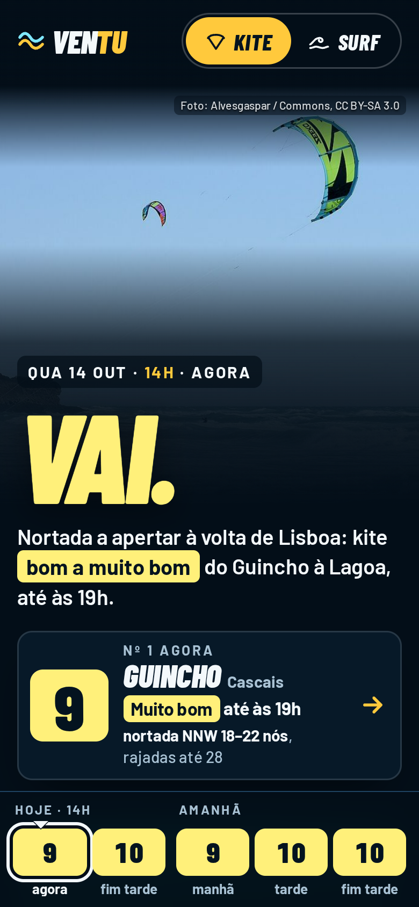
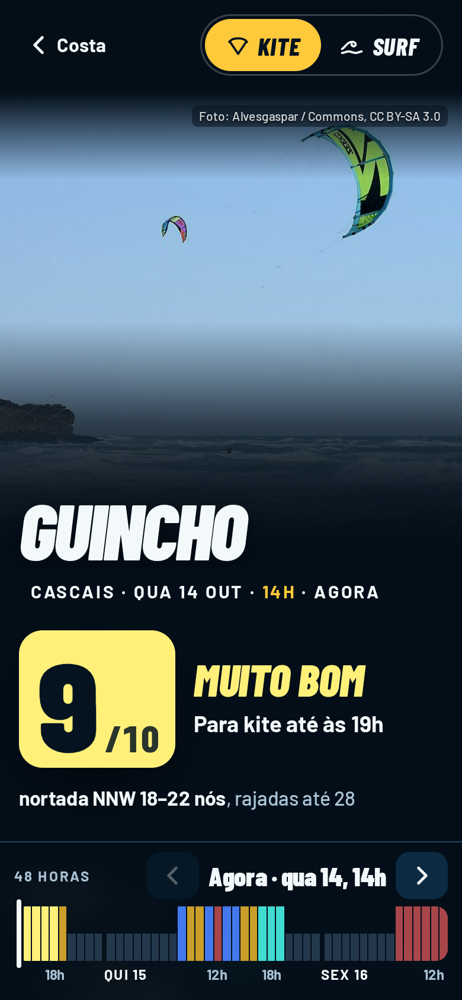
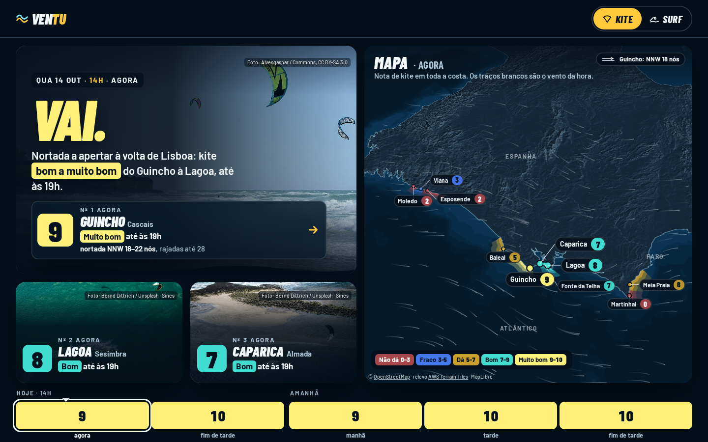
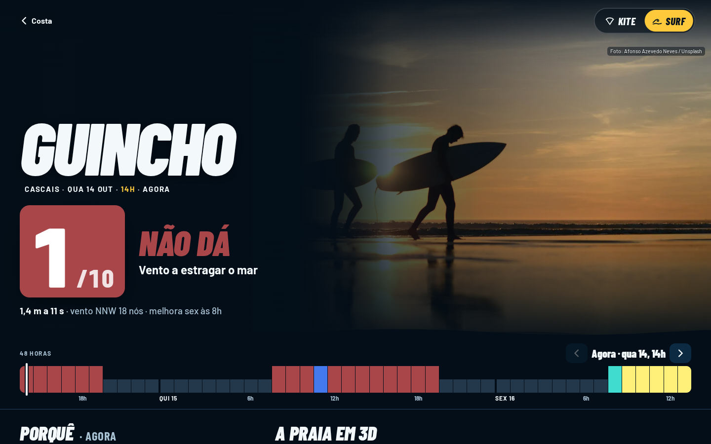

# Maquete v6 «Atlântico»: home e página de spot (direcção aprovada)

**Aprovada pelo Pedro a 14 out 2026** («afina e passa à issue»). É o **contrato visual** das issues #183 (home v6) e #184 (página de spot v6). Substitui o visual das maquetes v5 ([`../home/`](../home/), [`../spot/`](../spot/)): calcário, Cinzel, rumos de portulano e o ar de carta náutica foram **recusados**. Mantém-se tudo o resto das v5: a arquitectura da informação, o ranking único, a escala 0–10 e as bandas (#210), a [regra de ouro](../README.md#a-regra-de-ouro), a régua de 48 h e a cena 3D do terreno.

**Âmbito: só surf e kite.** O selector tem apenas Kite e Surf; as outras modalidades das v5 ficam fora por agora (o modelo de dados continua extensível).

## Abrir
Descarregar a pasta inteira e abrir no browser (funciona a partir do disco):
- [`index.html`](index.html): home. Parâmetros: `?d=kite|surf`, `?b=0-tarde|0-fim|1-manha|1-tarde|1-fim` (bloco), `?agora=2026-10-14T22:00`, `?webgl=0` (mapa plano), `?tema=sol` (corpo claro).
- [`guincho.html`](guincho.html): página de spot (Guincho). Parâmetros: `?d=kite|surf`, `?h=0..47` (hora), `?estudo=1` (abre «Estudar o spot»), `?webgl=0`.
- Fontes (Barlow Condensed e Barlow, OFL), MapLibre GL 4.7.1 e o CSS em [`lib/`](lib/); fotos em [`fotos/`](fotos/) (WebP do Unsplash, recomprimidas para o repositório: ≤ 1600 px q72 e cartões 900 px; uma JPEG do Commons). O relevo 3D vem em directo dos AWS Terrain Tiles (precisa de rede).
- A previsão é inventada (14–16 out 2026), coerente hora a hora; é a mesma das maquetes v5.

## Documentos
- [`LEIA-ME.md`](LEIA-ME.md): o que é, regras, vento, fotos (notas de construção; os caminhos `_build/` referem-se ao ambiente de trabalho e não estão no repositório).
- [`cores.md`](cores.md): paleta, rampa das bandas e verificações de contraste e daltonismo.
- [`critica.md`](critica.md): autocrítica por área, ronda a ronda (ronda 5 = afinação pós-aprovação).
- [`CREDITOS.md`](CREDITOS.md): autor, licença e local de cada foto, com as substitutas marcadas.
- [`verifica-paridade.js`](verifica-paridade.js): paridade de dados com as maquetes v5 desta pasta (spot: nota e frase nas 48 h, kite e surf; home: ranking, frase nacional e linhas do top 3 de cada bloco). Resultado a 14 out 2026: **PARIDADE OK** (0 diferenças).

## Capturas (viewport, nunca página inteira)
| 390 · home kite | 390 · spot kite | 1440 · home kite | 1440 · spot surf |
|---|---|---|---|
|  |  |  |  |

Todas em [`capturas/`](capturas/): home 390 (kite, surf, faixa do mapa, mapa em ecrã inteiro), home 1440 (kite, surf, amanhã à tarde), spot 390 (kite, surf, Porquê, cena 3D), spot 1440 (kite, surf, Porquê + praia 3D) e extras (sem WebGL + reduced-motion na home e no spot, noite, tema sol).

## Fora do repositório
`_build/` (modelos, `assemble.py`, `vento.js`, scripts de cores, fotos e capturas, Chromium, fotos originais em 2000 px): ~150 MB de trabalho. O `vento.js` e o CSS já vão embutidos nos dois HTML.
